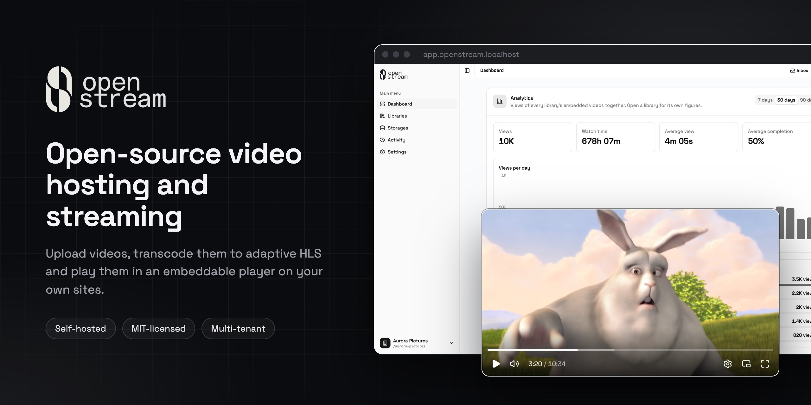
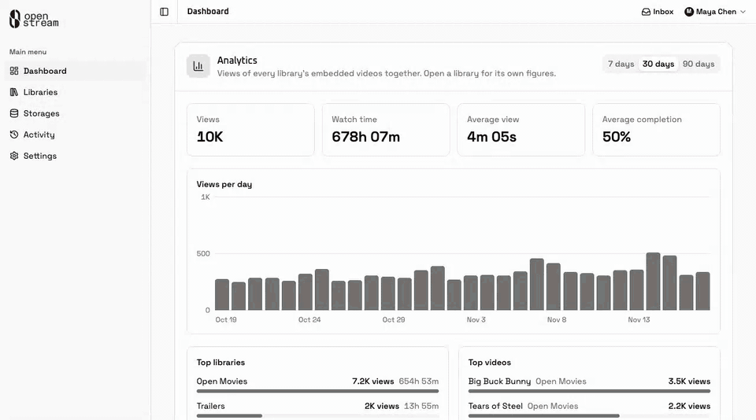
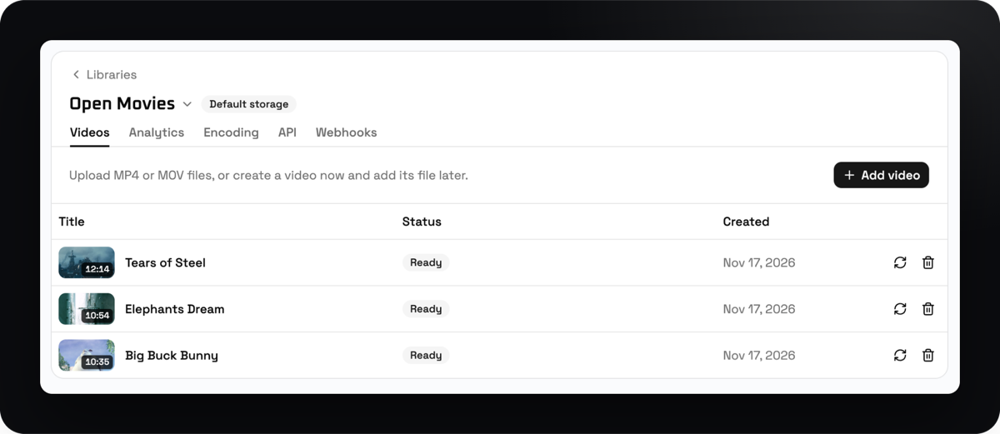
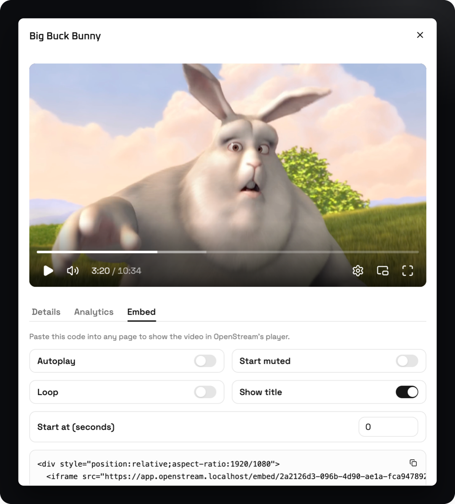
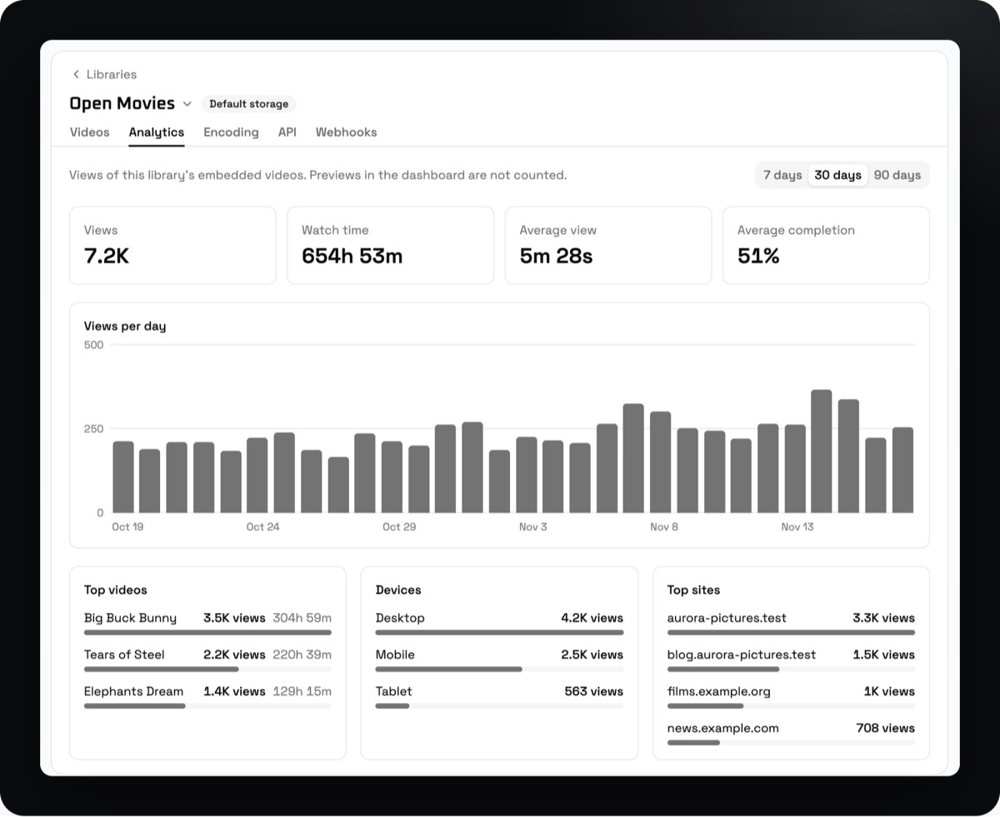
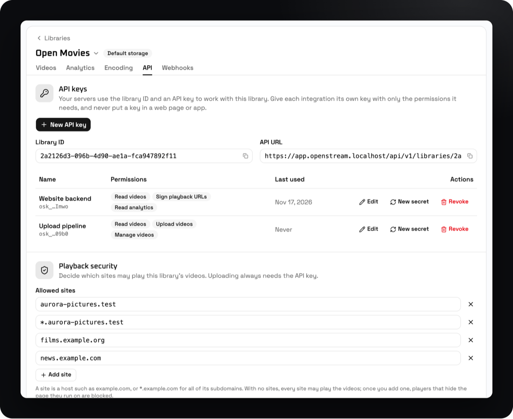
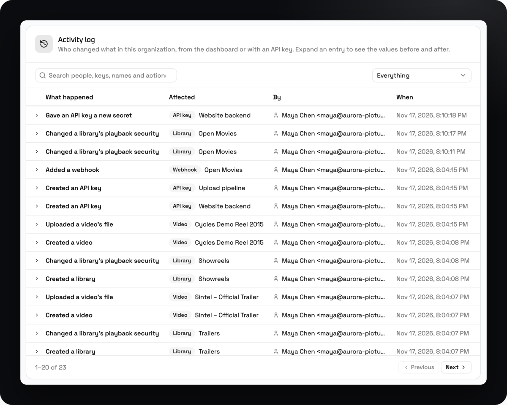
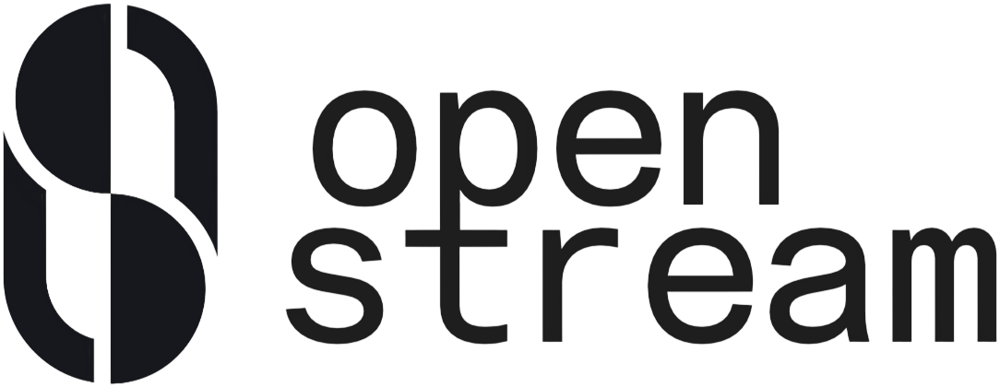

<a name="readme-top"></a>

<p align="center">
  
</p>

<p align="center">
  <strong>OpenStream is a self-hosted video platform: upload videos, transcode them to adaptive HLS and play them in an embeddable player on your own sites.</strong><br/>
  MIT-licensed and multi-tenant - keep your videos in your own S3-compatible buckets, decide which sites may play them, and see who watches.
</p>

<p align="center">
  <a href="LICENSE"></a>
  <a href="https://github.com/its-gabo/open-stream/stargazers"></a>
  
  
  
  
</p>

<p align="center">
  <a href="#quick-start"><strong>Quick start</strong></a> ·
  <a href="#features">Features</a> ·
  <a href="#security">Security</a> ·
  <a href="#faq">FAQ</a>
</p>

<br />

## See it in action

<p align="center">
  
</p>

<br />

## Who is it for

<table>
  <tr>
    <td width="33%" align="center" valign="top">
      <br />
      
      <h3>Teams publishing video</h3>
      <p>Courses, product demos, marketing - published on your own sites, with a player you control, without third-party branding, tracking or recommendations.</p>
    </td>
    <td width="33%" align="center" valign="top">
      <br />
      
      <h3>Developers</h3>
      <p>A typed OpenAPI, scoped API keys, resumable uploads and signed webhooks let your backend create, upload, sign and track videos without touching the dashboard.</p>
    </td>
    <td width="33%" align="center" valign="top">
      <br />
      
      <h3>Organizations</h3>
      <p>Need your media in your own infrastructure? Connect your own S3-compatible bucket per library, with credentials encrypted at rest, and choose exactly which sites may play each library.</p>
    </td>
  </tr>
</table>

<br />

## Quick start

> [!NOTE]
> **Prerequisites:** [Bun](https://bun.sh) 1.3, Docker with Docker Compose, [Caddy](https://caddyserver.com/docs/install) and [ffmpeg](https://ffmpeg.org). Everything runs locally, with the services in Docker.

```bash
git clone https://github.com/its-gabo/open-stream.git
cd open-stream
caddy trust             # once, so the local HTTPS domains work
cp .env.example .env    # set AUTH_SECRET and STORAGE_ENCRYPTION_KEY
docker compose up -d    # PostgreSQL, Redis, Mailpit and RustFS
bun install
bun run db:migrate
bun run db:seed         # optional: demo accounts, libraries and videos
bun run dev             # web app, API, worker and reverse proxy
```

> [!TIP]
> Generate the secrets with `openssl rand -hex 32` (`AUTH_SECRET`) and `openssl rand -base64 32` (`STORAGE_ENCRYPTION_KEY`).

Then open **https://app.openstream.localhost**, sign up, and confirm your email in the local mailbox:

| URL                                  | Service                                        |
| ------------------------------------ | ---------------------------------------------- |
| https://app.openstream.localhost     | Web app (`/api/*` goes to the API)             |
| https://landing.openstream.localhost | Landing page (`bun run dev:landing`)           |
| https://mailbox.openstream.localhost | Mailpit (sent emails)                          |
| https://storage.openstream.localhost | RustFS console (`rustfsadmin` / `rustfsadmin`) |

The API describes itself at `https://app.openstream.localhost/api/v1/openapi.json`.

<br />

## At a glance

<table>
  <tr>
    <td>&nbsp;&nbsp;<strong>Upload</strong></td>
    <td>Resumable <a href="https://tus.io">tus</a> uploads in 16 MiB chunks, MP4 and MOV, up to 20 GiB</td>
  </tr>
  <tr>
    <td>&nbsp;&nbsp;<strong>Transcode</strong></td>
    <td>HLS in 360p, 480p, 720p and 1080p with ffmpeg, plus a poster and a storyboard</td>
  </tr>
  <tr>
    <td>&nbsp;&nbsp;<strong>Store</strong></td>
    <td>Built-in object storage, or your own S3-compatible buckets per library</td>
  </tr>
  <tr>
    <td>&nbsp;&nbsp;<strong>Play</strong></td>
    <td>Embeddable player, allowed sites, optional signed and expiring URLs</td>
  </tr>
  <tr>
    <td>&nbsp;&nbsp;<strong>Measure</strong></td>
    <td>Views, watch time, completion, retention, devices and embedding sites</td>
  </tr>
  <tr>
    <td>&nbsp;&nbsp;<strong>Integrate</strong></td>
    <td>Library API with scoped keys, Standard Webhooks, generated TypeScript client</td>
  </tr>
  <tr>
    <td>&nbsp;&nbsp;<strong>Audit</strong></td>
    <td>Organization and account activity logs with before and after values</td>
  </tr>
</table>

<br />

## Features

<table>
  <tr>
    <td width="50%" valign="middle">

###  Upload and processing

- **Resumable uploads.** Files go up with the tus protocol and straight into an object storage multipart upload, so an interrupted upload continues where it stopped.
- **Adaptive streaming.** One ffmpeg pass turns each video into HLS in the qualities its library chooses, measured on the short side so portrait videos get the same ladder. Nothing is upscaled.
- **Seek previews.** Every video gets a poster and a storyboard sprite with a WebVTT index, shown when you scrub.
- **CPU or GPU.** Encode with x264, or switch `VIDEO_ENCODER` to `videotoolbox` or `nvenc`.

</td>
    <td width="50%" valign="middle">
      
    </td>
  </tr>
  <tr>
    <td width="50%" valign="middle">
      
    </td>
    <td width="50%" valign="middle">

###  Player and embedding

- **Embeddable player.** Copy an `<iframe>` from the video's **Embed** tab, with autoplay, mute, loop, start time and title options.
- **Allowed sites.** Each library lists the sites that may play it. The player sends them as `frame-ancestors`, so no other page can frame it.
- **Signed playback.** Optionally accept only expiring URLs signed by your server. Revoking the signing key revokes its URLs.

</td>
  </tr>
  <tr>
    <td width="50%" valign="middle">

###  Analytics

- **Real viewing data.** Players report watched seconds and position every 15 seconds, and the server caps each report by the real time that passed.
- **Three levels.** Views, watch time, average view, completion, daily views, devices and embedding sites for the organization, each library and each video, over 7, 30 or 90 days.
- **Retention.** See the share of viewers still watching at each point of a video.

</td>
    <td width="50%" valign="middle">
      
    </td>
  </tr>
  <tr>
    <td width="50%" valign="middle">
      
    </td>
    <td width="50%" valign="middle">

###  API and webhooks

- **Library API.** Up to 25 named keys per library, each limited to `videos:read`, `videos:upload`, `videos:manage`, `playback:sign` or `analytics:read`.
- **Webhooks.** `video.*` events for creation, uploads and every processing step, signed per [Standard Webhooks](https://www.standardwebhooks.com) and retried with backoff. Deliveries can be inspected, tested and resent.
- **Typed client.** The web app uses a client generated from the OpenAPI schema, and so can yours.

</td>
  </tr>
  <tr>
    <td width="50%" valign="middle">

###  Organizations

- **Multi-tenant.** Organizations with members, invitations, ownership transfer and scheduled deletion.
- **Bring your own storage.** Connect S3-compatible buckets, test them, choose a folder layout, and assign them to libraries.
- **Activity logs.** Every change is recorded with who made it, from where, and the values before and after.

</td>
    <td width="50%" valign="middle">
      
    </td>
  </tr>
</table>

<br />

## Security

<table>
  <tr>
    <td width="200">&nbsp;&nbsp;<strong>Tenant&nbsp;isolation</strong></td>
    <td>Dashboard routes require membership of the organization, and library API keys work only on their own library.</td>
  </tr>
  <tr>
    <td width="200">&nbsp;&nbsp;<strong>Secrets&nbsp;at&nbsp;rest</strong></td>
    <td>API keys are stored as SHA-256 hashes. Storage credentials are envelope-encrypted and webhook secrets encrypted with <code>STORAGE_ENCRYPTION_KEY</code>; neither is returned by the API after it is created.</td>
  </tr>
  <tr>
    <td width="200">&nbsp;&nbsp;<strong>CSRF&nbsp;and&nbsp;sessions</strong></td>
    <td>Cookie-authenticated requests must come from the web app's origin. The library API uses bearer keys and sends no cookies.</td>
  </tr>
  <tr>
    <td width="200">&nbsp;&nbsp;<strong>Safe&nbsp;webhooks</strong></td>
    <td>In production, webhook URLs must be public HTTPS and are resolved before each delivery to refuse private addresses. Redirects are not followed.</td>
  </tr>
</table>

<br />

## FAQ

<details>
<summary><strong>Do I need a GPU?</strong></summary>
<br/>

No. x264 on the CPU is the default and works everywhere. On a Mac, `VIDEO_ENCODER=videotoolbox` uses the hardware encoder, and `nvenc` does the same on NVIDIA GPUs.

</details>

<details>
<summary><strong>Where are my videos stored?</strong></summary>
<br/>

In the default S3-compatible storage from `OBJECT_STORAGE_*` (RustFS locally), or in your own bucket. Each library can use a different storage, with its own folder layout.

</details>

<details>
<summary><strong>Can I stop other sites from using my videos?</strong></summary>
<br/>

Yes. Add allowed sites to a library and only those sites can frame the player or stream its HLS. For stricter control, require signed URLs that your server creates and that expire.

</details>

<details>
<summary><strong>How are views counted?</strong></summary>
<br/>

A view starts when the player starts playing. The player then reports how much was watched every 15 seconds, and the server caps each report by the time that actually passed. Viewers are not identified.

</details>

<details>
<summary><strong>Can I upload from my own backend?</strong></summary>
<br/>

Yes. Create a library API key with `videos:upload`, create a video, and upload its file with any tus client to `/api/v1/libraries/<library-id>/videos/<video-id>/uploads`.

</details>

<br />

## Built with

<p>
  
  
  
  
  
  
  
  
  
  
  
  
</p>

<br />

## License

OpenStream is released under the [MIT License](LICENSE).

<br />

<p align="center">
  <picture>
    <source media="(prefers-color-scheme: dark)" srcset="docs/assets/openstream-logo-dark.png" />
    
  </picture>
  <br />
  <a href="#readme-top">Back to top ↑</a>
</p>
